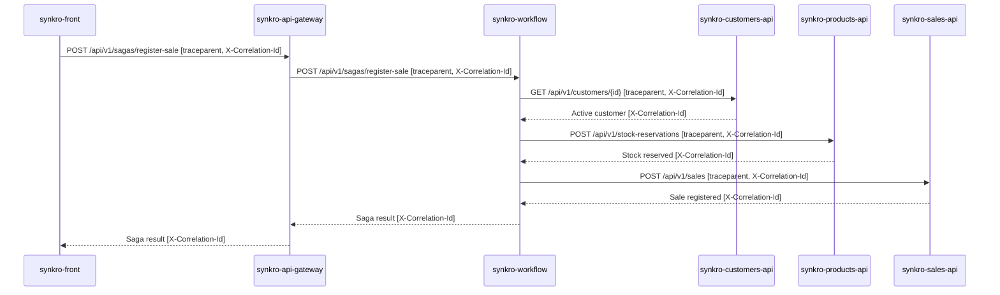

# Sale Registration Journey

## 1. Selected journey

I selected sale registration in SynkroTech.
The system checks the customer, reserves stock and saves the sale.
This journey is important because a sale needs a valid customer
and enough available stock.

Workflow coordinates the calls to Customers, Products and Sales.
The following steps describe a successful request.

## 2. Request steps

| Step | Caller | Receiver | Operation | Protocol | Mode | Data |
|---|---|---|---|---|---|---|
| 1 | synkro-front | synkro-api-gateway | POST /api/v1/sagas/register-sale | HTTP/JSON | Sync | Customer ID and product quantities |
| 2 | synkro-api-gateway | synkro-workflow | POST /api/v1/sagas/register-sale | HTTP/JSON | Sync | Saga state in workflow_schema |
| 3 | synkro-workflow | synkro-customers-api | GET /api/v1/customers/{id} | HTTP/JSON | Sync | Customer in customers_schema |
| 4 | synkro-workflow | synkro-products-api | POST /api/v1/stock-reservations | HTTP/JSON | Sync | Stock reservation in products_schema |
| 5 | synkro-workflow | synkro-sales-api | POST /api/v1/sales | HTTP/JSON | Sync | Sale document in MongoDB sales |

If the customer is missing or inactive, the process stops before
reserving stock. If stock is insufficient, the sale is not registered.

## 3. Trace context

A trace follows one request through the services.
All operations in that trace share the same trace_id.
Each operation has a different span_id.

The traceparent HTTP header carries the trace context.
An outgoing call creates a client span. The receiving service
creates a server span using that client span as its parent.

Synkro already documents X-Correlation-Id.
For this workshop, I propose sending traceparent alongside it.
These headers have different purposes and are not interchangeable.
This is a proposed design, not proof of tracing already deployed
across all services.

## 4. Sequence diagram

## 5. Span tree

All spans below share one trace_id.

- Frontend: submit sale [CLIENT, root]
  - Gateway: receive request [SERVER]
    - Gateway: call Workflow [CLIENT]
      - Workflow: register sale [SERVER]
        - Workflow: call Customers [CLIENT]
          - Customers: get customer [SERVER]
        - Workflow: call Products [CLIENT]
          - Products: reserve stock [SERVER]
        - Workflow: call Sales [CLIENT]
          - Sales: register sale [SERVER]

## 6. Asynchronous boundary

This selected path uses synchronous HTTP calls.
It does not include a message queue or a broker.
RabbitMQ is deferred in the project's architecture.

Later polling or recovery of a RUNNING saga is outside this example.
The request trace must not remain open indefinitely while waiting
for a later recovery.

## 7. Instrumentation for CP3

I will instrument a minimal Workflow module and its HTTP call
to Customers. The test will check that the incoming trace_id
is also present in the outgoing traceparent header.

A controlled downstream server will be used for this test.
This checks trace propagation, not full-platform integration.

## 8. Sources

- [Service catalog](https://github.com/code-corhuila/synkro-docs/blob/main/09-microservices/service-catalog.md)
- [Cross-cutting concerns](https://github.com/code-corhuila/synkro-docs/blob/main/05-architecture/cross-cutting.md)
- [Workflow API](https://github.com/code-corhuila/synkro-docs/blob/main/07-api/contracts/openapi/synkro-workflow.yaml)
- [Customers API](https://github.com/code-corhuila/synkro-docs/blob/main/07-api/contracts/openapi/synkro-customers-api.yaml)
- [Products API](https://github.com/code-corhuila/synkro-docs/blob/main/07-api/contracts/openapi/synkro-products-api.yaml)
- [Sales API](https://github.com/code-corhuila/synkro-docs/blob/main/07-api/contracts/openapi/synkro-sales-api.yaml)