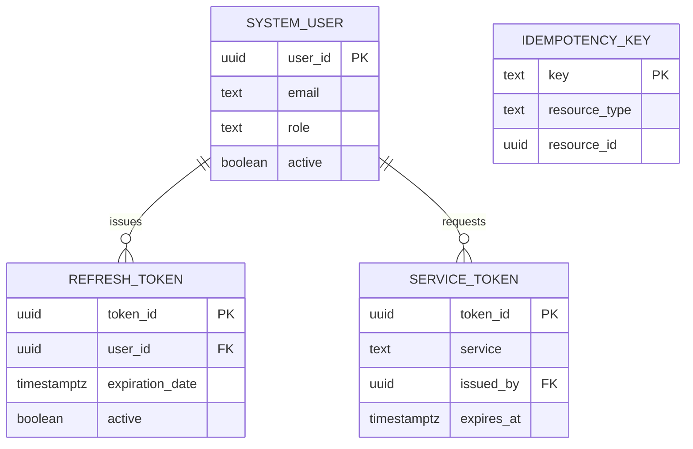
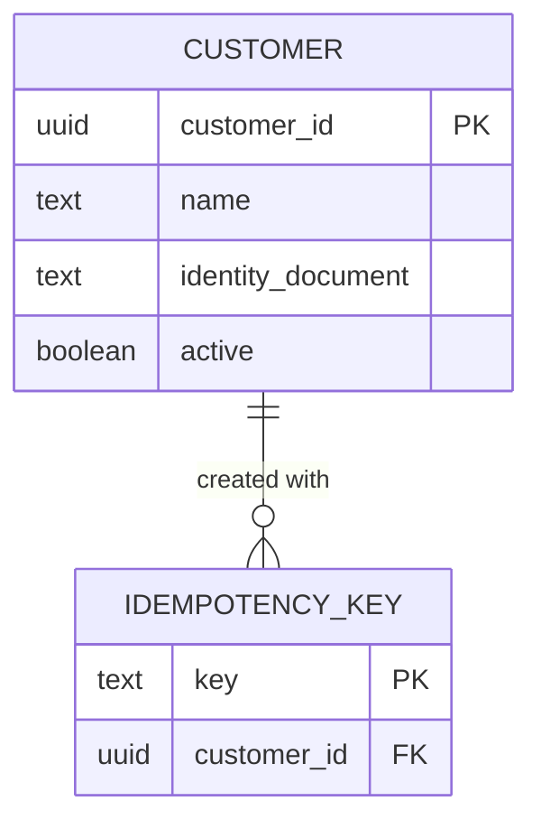
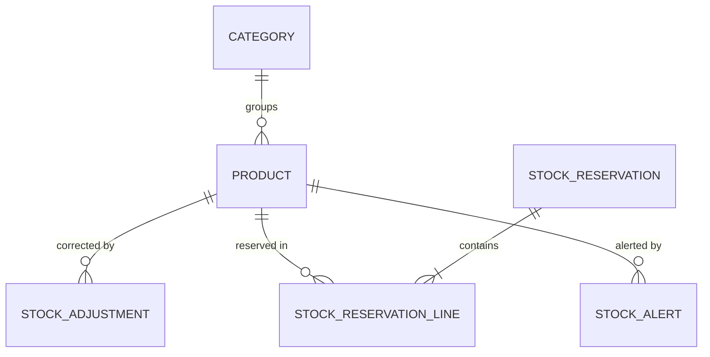
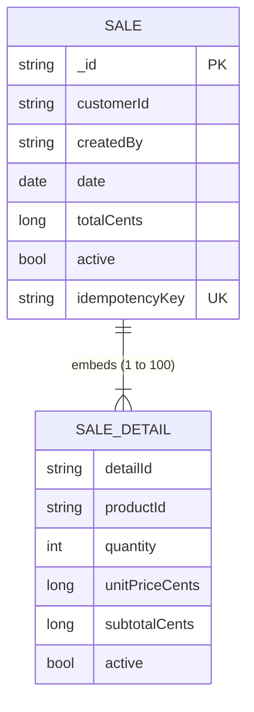

# Data Models per Domain

> The data model of each domain. The system uses two engines. Auth,
> Customers, Products and the saga store share **one PostgreSQL instance
> per environment**, defined and started by `synkro-infra-postgres`, each in its
> own schema (`<domain>_schema`). Sales has its own database in **one
> MongoDB instance per environment**, defined and started by
> `synkro-infra-mongo`. Every store is migrated by the `-db` repository
> of its domain, and no service connects to the store of another domain
> (ADR-009, ADR-010, ADR-012; ADR-005 Decisions 2–5).
>
> The field list comes from ADR-001 §7; ADR-005 changed the table names,
> the money types and the constraint conventions, and ADR-010 moved Sales
> to documents. This document gives what each `-db` repository implements.

---

## Data modeling principles

### 1. One store per domain (mandatory)
A service reads and writes only the store of its own domain: its schema in the shared PostgreSQL instance, or its database in the MongoDB instance. Data from another domain is requested through that domain's API, never by querying its store — not even inside the same instance. No `-db` grants its reader role to another domain's user (ADR-012).

```
✓ synkro-customers-api → customers_schema (shared PostgreSQL instance, user customers_app)
✓ synkro-sales-api     → database sales (MongoDB instance, user sales_app)
✓ sales portal         → GET /api/v1/customers/{id} → synkro-customers-api → customers_schema
✗ synkro-products-api  → any query against customers_schema (same instance, but no GRANT)
✗ any other service    → the MongoDB instance (no credentials)
```

### 2. Audit field: `active`, not `deleted_at`
Soft delete uses a boolean `active` field on every table whose rows can be
deactivated, not the generic `deleted_at` pattern. A row is considered
deleted when `active = false`. Records that are never edited (stock
adjustments, reservation lines, idempotency keys) have no `active` field,
and records with a lifecycle (reservations, alerts, sagas) use a `status`.
Timestamp fields keep their business names (`registration_date`, `date`).

### 3. Soft delete by default
Never delete a record with a physical `DELETE`. Set `active = false`
instead. This preserves traceability (NFR-009). The database enforces it:
the service's role has no `DELETE` permission (principle 6).

In MongoDB the rule is the same: the role `sales_writer` can find, insert and update, and has no action to remove documents.

### 4. Conventions (PostgreSQL) 

| Element | Rule | Example |
|---|---|---|
| Schema | Named after the domain with `_schema` suffix; nothing lives in `public` | `customers_schema` |
| Tables | Singular `snake_case`, named after one row | `customer`, `stock_reservation_line`, `system_user` (`user` is reserved) |
| Text | `text`, with a named `CHECK` on length when the business sets a limit | `chk_customer_name_length` |
| Closed sets | Named `CHECK`, never `ENUM` | `chk_system_user_role` |
| Money | `bigint` in minor units (1/100 COP), named `…_cents` | `price_cents` |
| Timestamps | `timestamptz` | `registration_date` |
| Constraints | Explicit names: `pk_<table>`, `fk_<table>_<target>`, `uq_<table>_<columns>`, `chk_<table>_<rule>` | `uq_customer_identity_document` |
| Foreign keys | Only inside the same domain; added after the tables, with `ON DELETE RESTRICT` and their own index | `fk_refresh_token_user` |
| External references | `<entity>_id` as a plain UUID, no foreign key, verified through the owning domain's API | `stock_adjustment.adjusted_by` |
| Indexes | `idx_<table>_<columns>`; each one serves a known query | `idx_refresh_token_user_id` |

### 4b. Conventions (MongoDB, Sales)

| Element | Rule | Example |
|---|---|---|
| Database | One per domain inside the instance, named after the domain | `sales` |
| Collections | Singular `snake_case`, named after one document | `sale` |
| Fields | camelCase, the same names as the API contract | `totalCents`, `createdBy` |
| Structure | A `$jsonSchema` validator on every collection, with `additionalProperties: false`, `validationLevel: strict` and `validationAction: error` | undeclared fields are rejected |
| Identifiers | Canonical UUID as text; the document's `_id` is the entity's identifier | `_id` is `saleId` |
| Money | `long` in minor units (1/100 COP), named `…Cents`; never `double` | `unitPriceCents` |
| Timestamps | `date`, stored in UTC | `date` |
| Relationships | Embed what is read together; every embedded array declares `minItems` and `maxItems` | `details`, 1 to 100 |
| External references | `<entity>Id` as a plain UUID, verified through the owning domain's API | `customerId` |
| Uniqueness | Unique indexes, named `uq_<collection>_<fields>` | `uq_sale_idempotency_key` |
| Indexes | `idx_<collection>_<fields>`; each one serves a known query | `idx_sale_created_by_date` |
| Rules between fields | Enforced by the service's domain, with tests; the validator checks only types and ranges | `subtotalCents = quantity * unitPriceCents` |

### 5. Migrations 
Each `-db` repository organizes its migrations by family, with one version sequence for the whole repository. The number, not the folder, decides the order. Every `V<n>` has its rollback `U<n>` under `05_rollbacks/`, which Flyway never runs on its own (ADR-005).

`flyway.toml` declares the domain's schema as its only schema and its default schema, so the migration history table lives inside `<domain>_schema` and no two repositories share it (ADR-012). The CI rebuild check drops that table before the `U` script that drops the schema.

**Sales (Liquibase).** `synkro-sales-db` uses Liquibase with its MongoDB extension (ADR-010). `changelog/changelog-master.yaml` is the only entry point and includes each family in order. Every changeset is idempotent on its own and declares its inverse in line; there are no folders for foreign keys, transaction control or mirrored rollbacks.

```
synkro-sales-db/
├── 01_ddl/00_collections/changelog.yaml   # sale, created with its validator
├── 01_ddl/01_validators/changelog.yaml    # later validator changes (collMod); empty at first
├── 01_ddl/02_indexes/changelog.yaml       # the four indexes of the sale collection
├── 01_ddl/03_views/changelog.yaml         # empty: reports are pipelines in the service
├── 01_ddl/changelog.yaml
├── 02_dml/…/changelog.yaml                # idempotent seeds; empty at first
├── 03_dcl/00_roles/changelog.yaml         # sales_reader, sales_writer, grant to sales_app
├── changelog/changelog-master.yaml
└── deploy/compose.yml, deploy/liquibase.Dockerfile   # the runner only
```

A validator is never changed by editing the changeset that created the collection: the change is a new changeset under `01_validators/`. The CI check applies everything on an empty database, applies again with zero changes, rolls everything back and applies again; it also inserts one valid document and confirms that an undeclared field, an out-of-range value and a sale with 101 lines are rejected.

### 6. Schemas, roles and credentials
- **Created only by the `-db`.** Each `-db` repository, and synkro-workflow for the saga store, owns its schema and NOLOGIN roles (ADR-012). The design calls for a reader and writer; the inspected Auth, Customers and Workflow migrations create both, while Products creates only products_writer. The missing Products reader and physical-schema convention differences remain open in [TD-018](../15-project-control/technical-backlog.md#td-018--products-physical-schema-conventions). Roles contain no password.
- **Service users, created by the instance.** The bootstrap script of `synkro-infra-postgres` creates one login user per domain — `auth_app`, `customers_app`, `products_app`, `workflow_app` — with its `search_path` set to its schema and no privilege of its own. The user name is fixed; only its password is a secret (`<DOMAIN>_APP_PASSWORD`). In the CI of a `-db`, which rebuilds on an ephemeral instance without that script, the job creates the user before migrating.
- **The grant.** Writer membership targets the fixed domain login by name, never an app_user placeholder. Auth V003 and Products V003 configure the migration owner's default table privileges in their own schema; Auth V005 adds reader defaults and V017 removes UPDATE on the audit table. Customers V007 and Workflow V005 explicitly grant only their application tables and revoke access to migration history. Inspect each concrete migration below and verify effective privileges; do not copy a blanket ALL TABLES grant onto a schema containing history or append-only evidence.
- **Who connects as what.** Services connect as `<domain>_app`, never as the administrator. Migration runners connect with the instance administrator's credentials, which nothing else uses.
- **Sales.** `synkro-sales-db` creates the roles `sales_reader` (find) and `sales_writer` (find, insert, update; no remove) in the `sales` database, and grants `sales_writer` to `sales_app`. The bootstrap script of `synkro-infra-mongo` creates `sales_app`.
- **Check.** After migrating an environment, the privilege check of `05-architecture/deployment.md` must show each `_app` user reading and writing only its own schema.

### 7. Idempotency keys
Every domain that creates resources over HTTP stores the `Idempotency-Key`
of each creation. The key has 8 to 128 characters.

- **PostgreSQL domains:** an `idempotency_key` table. The service writes the
  resource and its key in **one transaction**; if the key already exists, it
  rolls back and returns the original resource (ADR-005). When a domain
  creates one kind of resource, the key has a foreign key to it; when it
  creates several, it stores the resource type and identifier
  (`resource_type`, `resource_id`).
- **Sales:** the key is the field `idempotencyKey` of the sale document, with
  the unique index `uq_sale_idempotency_key`. The sale and its key are one
  atomic write; if the index rejects the insert, the service reads the sale
  that holds the key and returns it (ADR-010).

---

## Domain: `auth`

**Schema:** `auth_schema` (shared instance) · **Repository:** `synkro-auth-db`

**Engine justification:** ACID guarantees are required for user credentials and role assignment — a user must never exist without a role. See `01-context/overview.md`, "Alternatives Considered".

**Delivered migrations at the inspected revision.** The paths and SQL below come from synkro-auth-db; they replace earlier illustrative numbering. They describe source delivery, not a new migration run or a claim that every environment has applied it.

| Version | Delivered migration |
|---|---|
| V001 | [01_ddl/01_schemas/V001__create_schema_auth.sql](https://github.com/code-corhuila/synkro-auth-db/blob/6c8270372adca0bee7a6e62a8f14c33a9d8977e5/01_ddl/01_schemas/V001__create_schema_auth.sql) |
| V002 | [03_dcl/00_roles/V002__create_roles.sql](https://github.com/code-corhuila/synkro-auth-db/blob/6c8270372adca0bee7a6e62a8f14c33a9d8977e5/03_dcl/00_roles/V002__create_roles.sql) |
| V003 | [03_dcl/01_grants/V003__grants.sql](https://github.com/code-corhuila/synkro-auth-db/blob/6c8270372adca0bee7a6e62a8f14c33a9d8977e5/03_dcl/01_grants/V003__grants.sql) |
| V004 | [03_dcl/00_roles/V004__create_auth_reader_role.sql](https://github.com/code-corhuila/synkro-auth-db/blob/6c8270372adca0bee7a6e62a8f14c33a9d8977e5/03_dcl/00_roles/V004__create_auth_reader_role.sql) |
| V005 | [03_dcl/01_grants/V005__grant_auth_reader.sql](https://github.com/code-corhuila/synkro-auth-db/blob/6c8270372adca0bee7a6e62a8f14c33a9d8977e5/03_dcl/01_grants/V005__grant_auth_reader.sql) |
| V006 | [01_ddl/03_tables/V006__create_system_user.sql](https://github.com/code-corhuila/synkro-auth-db/blob/6c8270372adca0bee7a6e62a8f14c33a9d8977e5/01_ddl/03_tables/V006__create_system_user.sql) |
| V007 | [01_ddl/03_tables/V007__create_refresh_token.sql](https://github.com/code-corhuila/synkro-auth-db/blob/6c8270372adca0bee7a6e62a8f14c33a9d8977e5/01_ddl/03_tables/V007__create_refresh_token.sql) |
| V008 | [01_ddl/04_alter/V008__add_refresh_token_foreign_key.sql](https://github.com/code-corhuila/synkro-auth-db/blob/6c8270372adca0bee7a6e62a8f14c33a9d8977e5/01_ddl/04_alter/V008__add_refresh_token_foreign_key.sql) |
| V009 | [01_ddl/10_indexes/V009__create_refresh_token_indexes.sql](https://github.com/code-corhuila/synkro-auth-db/blob/6c8270372adca0bee7a6e62a8f14c33a9d8977e5/01_ddl/10_indexes/V009__create_refresh_token_indexes.sql) |
| V010 | [01_ddl/03_tables/V010__create_service_token.sql](https://github.com/code-corhuila/synkro-auth-db/blob/6c8270372adca0bee7a6e62a8f14c33a9d8977e5/01_ddl/03_tables/V010__create_service_token.sql) |
| V011 | [01_ddl/03_tables/V011__create_idempotency_key.sql](https://github.com/code-corhuila/synkro-auth-db/blob/6c8270372adca0bee7a6e62a8f14c33a9d8977e5/01_ddl/03_tables/V011__create_idempotency_key.sql) |
| V012 | [01_ddl/04_alter/V012__add_service_token_foreign_key.sql](https://github.com/code-corhuila/synkro-auth-db/blob/6c8270372adca0bee7a6e62a8f14c33a9d8977e5/01_ddl/04_alter/V012__add_service_token_foreign_key.sql) |
| V013 | [01_ddl/10_indexes/V013__create_service_token_indexes.sql](https://github.com/code-corhuila/synkro-auth-db/blob/6c8270372adca0bee7a6e62a8f14c33a9d8977e5/01_ddl/10_indexes/V013__create_service_token_indexes.sql) |
| V014 | [01_ddl/03_tables/V014__create_user_creation_audit.sql](https://github.com/code-corhuila/synkro-auth-db/blob/6c8270372adca0bee7a6e62a8f14c33a9d8977e5/01_ddl/03_tables/V014__create_user_creation_audit.sql) |
| V015 | [01_ddl/04_alter/V015__add_user_creation_audit_foreign_keys.sql](https://github.com/code-corhuila/synkro-auth-db/blob/6c8270372adca0bee7a6e62a8f14c33a9d8977e5/01_ddl/04_alter/V015__add_user_creation_audit_foreign_keys.sql) |
| V016 | [01_ddl/10_indexes/V016__create_user_creation_audit_indexes.sql](https://github.com/code-corhuila/synkro-auth-db/blob/6c8270372adca0bee7a6e62a8f14c33a9d8977e5/01_ddl/10_indexes/V016__create_user_creation_audit_indexes.sql) |
| V017 | [03_dcl/01_grants/V017__grant_user_creation_audit.sql](https://github.com/code-corhuila/synkro-auth-db/blob/6c8270372adca0bee7a6e62a8f14c33a9d8977e5/03_dcl/01_grants/V017__grant_user_creation_audit.sql) |

```sql
-- 01_ddl/01_schemas/V001__create_schema_auth.sql
CREATE SCHEMA IF NOT EXISTS auth_schema;

-- 03_dcl/00_roles/V002__create_roles.sql
DO $$
BEGIN
  IF NOT EXISTS (SELECT FROM pg_roles WHERE rolname = 'auth_writer') THEN
    CREATE ROLE auth_writer NOLOGIN;
  END IF;
END $$;

-- 03_dcl/01_grants/V003__grants.sql
GRANT USAGE ON SCHEMA auth_schema TO auth_writer;
ALTER DEFAULT PRIVILEGES IN SCHEMA auth_schema
  GRANT SELECT, INSERT, UPDATE ON TABLES TO auth_writer;
GRANT auth_writer TO auth_app;

-- 03_dcl/00_roles/V004__create_auth_reader_role.sql
DO $$
BEGIN
  IF NOT EXISTS (SELECT FROM pg_roles WHERE rolname = 'auth_reader') THEN
    CREATE ROLE auth_reader NOLOGIN;
  END IF;
END $$;

-- 03_dcl/01_grants/V005__grant_auth_reader.sql
GRANT USAGE ON SCHEMA auth_schema TO auth_reader;
ALTER DEFAULT PRIVILEGES IN SCHEMA auth_schema
  GRANT SELECT ON TABLES TO auth_reader;

-- 01_ddl/03_tables/V006__create_system_user.sql
CREATE TABLE auth_schema.system_user (
  user_id            uuid        NOT NULL DEFAULT gen_random_uuid(),
  name               text        NOT NULL,
  email              text        NOT NULL,
  password_hash      text        NOT NULL,
  role               text        NOT NULL,
  registration_date  timestamptz NOT NULL DEFAULT now(),
  active             boolean     NOT NULL DEFAULT true,
  CONSTRAINT pk_system_user PRIMARY KEY (user_id),
  CONSTRAINT uq_system_user_email UNIQUE (email),
  CONSTRAINT chk_system_user_name_length CHECK (char_length(name) BETWEEN 1 AND 150),
  CONSTRAINT chk_system_user_email_length CHECK (char_length(email) BETWEEN 3 AND 255),
  -- SERVICE is not a user role: it exists only inside service tokens (ADR-006).
  CONSTRAINT chk_system_user_role CHECK (role IN ('ADMIN', 'SALESPERSON', 'INVENTORY'))
);

-- 01_ddl/03_tables/V007__create_refresh_token.sql
CREATE TABLE auth_schema.refresh_token (
  token_id         uuid        NOT NULL DEFAULT gen_random_uuid(),
  user_id          uuid        NOT NULL,
  -- the hash of the refresh token, never the token itself
  token            text        NOT NULL,
  expiration_date  timestamptz NOT NULL,
  active           boolean     NOT NULL DEFAULT true,
  CONSTRAINT pk_refresh_token PRIMARY KEY (token_id),
  CONSTRAINT uq_refresh_token_token UNIQUE (token)
);

-- 01_ddl/04_alter/V008__add_refresh_token_foreign_key.sql
ALTER TABLE auth_schema.refresh_token ADD CONSTRAINT fk_refresh_token_user
  FOREIGN KEY (user_id) REFERENCES auth_schema.system_user (user_id) ON DELETE RESTRICT;

-- 01_ddl/10_indexes/V009__create_refresh_token_indexes.sql
CREATE INDEX idx_refresh_token_user_id ON auth_schema.refresh_token (user_id);

-- 01_ddl/03_tables/V010__create_service_token.sql
-- Metadata of a service token. The signed token is never stored (ADR-006).
CREATE TABLE auth_schema.service_token (
  -- the jti, generated by the domain: no default, so a row cannot invent its own id
  token_id     uuid        NOT NULL,
  service      text        NOT NULL,
  permissions  text[]      NOT NULL,
  -- the ADMIN who requested the token; its foreign key is in V012
  issued_by    uuid        NOT NULL,
  issued_at    timestamptz NOT NULL DEFAULT now(),
  expires_at   timestamptz NOT NULL,
  CONSTRAINT pk_service_token PRIMARY KEY (token_id),
  CONSTRAINT chk_service_token_service CHECK (service IN ('synkro-workflow', 'synkro-worker')),
  CONSTRAINT chk_service_token_expiry CHECK (expires_at > issued_at)
);

-- 01_ddl/03_tables/V011__create_idempotency_key.sql
-- Protects both creations of the domain: user registration and service-token issuance.
-- resource_id has no foreign key on purpose: it names a user or a token depending on
-- resource_type, so no single table can be its parent.
CREATE TABLE auth_schema.idempotency_key (
  key            text        NOT NULL,
  resource_type  text        NOT NULL,
  resource_id    uuid        NOT NULL,
  created_at     timestamptz NOT NULL DEFAULT now(),
  CONSTRAINT pk_idempotency_key PRIMARY KEY (key),
  CONSTRAINT chk_idempotency_key_length CHECK (char_length(key) BETWEEN 8 AND 128),
  CONSTRAINT chk_idempotency_key_resource_type CHECK (resource_type IN ('USER', 'SERVICE_TOKEN'))
);

-- 01_ddl/04_alter/V012__add_service_token_foreign_key.sql
ALTER TABLE auth_schema.service_token ADD CONSTRAINT fk_service_token_issued_by
  FOREIGN KEY (issued_by) REFERENCES auth_schema.system_user (user_id) ON DELETE RESTRICT;

-- 01_ddl/10_indexes/V013__create_service_token_indexes.sql
CREATE INDEX idx_service_token_issued_by ON auth_schema.service_token (issued_by);
```

- `system_user.role` never takes `SERVICE`: that role exists only inside service tokens (ADR-006).
- `idempotency_key` protects both creations of this domain, user registration and service-token issuance, so it stores the type and the identifier of the resource, like Products (principle 7). A retried issuance finds its key, reads the token's metadata from `service_token` and returns it without the token (ADR-004 Decision 7).
- `refresh_token.token` is a stored credential hash, not a plaintext bearer credential. `active = false` records invalidation; `active = true` alone does not establish validity without checking `expiration_date`. Retain invalidated records for reuse detection; normal authentication and security lookup have different purposes. [Data dictionary](data-dictionary.md#auth-refresh-credential-semantics) defines the fields.
- `service_token` keeps only metadata: the service it was issued to, its permissions and its dates, so an issuance can be confirmed and its expiry tracked. The signed token is shown once and lives only in the `SERVICE_TOKEN` secret (ADR-006); it is never stored.



---

### User creation audit specification (ADR-014)

`auth_schema.user_creation_audit` stores successful user-creation evidence.
The implementation is delivered in V014 (table), V015 (foreign keys), V016 (index) and V017 (append-only grants) of synkro-auth-db. These are versioned migration sources, rather than a future-only specification. This review did not rerun migrations or inspect environment history; deployment application is established by that environment's evidence. Any correction uses a new forward migration, not an edit to an applied file.

[01_ddl/03_tables/V014__create_user_creation_audit.sql](https://github.com/code-corhuila/synkro-auth-db/blob/6c8270372adca0bee7a6e62a8f14c33a9d8977e5/01_ddl/03_tables/V014__create_user_creation_audit.sql); [01_ddl/04_alter/V015__add_user_creation_audit_foreign_keys.sql](https://github.com/code-corhuila/synkro-auth-db/blob/6c8270372adca0bee7a6e62a8f14c33a9d8977e5/01_ddl/04_alter/V015__add_user_creation_audit_foreign_keys.sql); [01_ddl/10_indexes/V016__create_user_creation_audit_indexes.sql](https://github.com/code-corhuila/synkro-auth-db/blob/6c8270372adca0bee7a6e62a8f14c33a9d8977e5/01_ddl/10_indexes/V016__create_user_creation_audit_indexes.sql); [03_dcl/01_grants/V017__grant_user_creation_audit.sql](https://github.com/code-corhuila/synkro-auth-db/blob/6c8270372adca0bee7a6e62a8f14c33a9d8977e5/03_dcl/01_grants/V017__grant_user_creation_audit.sql).

| Column | PostgreSQL type | Constraint / purpose |
|---|---|---|
| audit_id | uuid | Required; primary key `pk_user_creation_audit`; generated by Auth |
| operation | text | Required; `USER_REGISTERED` or `INITIAL_ADMIN_CREATED` |
| actor_kind | text | Required; `ADMIN` or `OPERATOR` |
| actor_user_id | uuid | ADMIN actor only; FK to system_user, ON DELETE RESTRICT |
| operator_identity | text | Nonempty deployment identity for OPERATOR only; maximum 200 characters |
| created_user_id | uuid | Required; FK to system_user, ON DELETE RESTRICT; unique |
| outcome | text | Required; always `SUCCESS`; failed attempts belong to security logs |
| occurred_at | timestamptz | Required; creation timestamp, presented in UTC |
| correlation_id | text | Required, nonempty; the HTTP or CLI execution correlation identifier |

Named checks enforce the closed sets and the actor combination: USER_REGISTERED
requires ADMIN, a non-null actor_user_id and no operator_identity;
INITIAL_ADMIN_CREATED requires OPERATOR, a non-null operator_identity and no
actor_user_id. The actor ADMIN role is checked by the use case at creation time,
not by a constraint on the actor's later role. No cross-schema FK is added.
Names follow principle 4: `chk_user_creation_audit_operation`,
`chk_user_creation_audit_actor_kind`, `chk_user_creation_audit_actor`,
`chk_user_creation_audit_outcome`, `chk_user_creation_audit_operator_identity`,
`chk_user_creation_audit_correlation_id`, `fk_user_creation_audit_actor`,
`fk_user_creation_audit_created_user`, `uq_user_creation_audit_created_user`.
Index actor_user_id as `idx_user_creation_audit_actor_user_id`; the unique
created_user_id index supports attribution lookup and its FK.

Normal permissions are SELECT/INSERT for auth_writer and SELECT for auth_reader;
no UPDATE, DELETE or TRUNCATE for application roles, PUBLIC or auth_app directly.
V017 revokes table privileges from PUBLIC, auth_app, auth_writer and auth_reader, then explicitly grants SELECT/INSERT to auth_writer and SELECT to auth_reader. It removes the UPDATE privilege inherited from the migration owner's V003 defaults for this table. Verify effective privileges as auth_app; a REVOKE from one role is
insufficient if another membership still grants modification. Table ownership stays
with the migration owner; auth_app cannot alter it or disable constraints.

Registration commits user, idempotency record and audit record together; initialization
commits user and audit record together. Authorized replay and initialization no-op
write no new creation record. Existing users are not assigned fabricated authorship;
this rule applies to creations after the ADR-014 implementation is deployed.

### Reserved advisory lock keys

| Database scope | Key / overload | Owner | Purpose |
|---|---|---|---|
| Each environment's shared PostgreSQL database | bigint 1398361682; transaction-level | Auth initialization | Initial administrator only; accepted ADR-014 protocol |
| Same database | two integers: 0x52544F4B, hashtext(userId); transaction-level | Auth refresh | Serialize rotation/reuse invalidation for one owner |
| Same database | two integers folded from saga UUID halves; session-level on one dedicated connection | Workflow execution | One executor lease across committed transitions; implementation record, isolation review pending |

This table is the central reservation/usage registry. Auth initialization uses the single-bigint overload, explicit READ COMMITTED, one connection/transaction and a separate existence query after locking. Its key is not schema-scoped or a lifetime marker. The bigint and two-integer key spaces are distinct; however, Workflow's unrestricted pair can overlap Auth refresh's pair namespace. Schema isolation does not isolate advisory locks. [TD-014](../15-project-control/technical-backlog.md#td-014--auth-and-workflow-two-key-lock-overlap) requires an explicit cross-service allocation/coexistence decision and deterministic collision tests; this table does not falsely mark the two pair users as isolated.
The initialization protocol and operational boundary are specified in
`13-operations/initial-administrator-initialization.md`.

## Domain: `customers`

**Schema:** `customers_schema` (shared instance) · **Repository:** `synkro-customers-db`

**Delivered migrations at the inspected revision.** The paths and SQL below come from synkro-customers-db; they replace earlier illustrative numbering. They describe source delivery, not a new migration run or a claim that every environment has applied it.

| Version | Delivered migration |
|---|---|
| V001 | [01_ddl/01_schemas/V001__create_customers_schema.sql](https://github.com/code-corhuila/synkro-customers-db/blob/4c24733e812adec24658fbce9d8518eda52adda4/01_ddl/01_schemas/V001__create_customers_schema.sql) |
| V002 | [01_ddl/03_tables/V002__create_customer.sql](https://github.com/code-corhuila/synkro-customers-db/blob/4c24733e812adec24658fbce9d8518eda52adda4/01_ddl/03_tables/V002__create_customer.sql) |
| V003 | [01_ddl/03_tables/V003__create_idempotency_key.sql](https://github.com/code-corhuila/synkro-customers-db/blob/4c24733e812adec24658fbce9d8518eda52adda4/01_ddl/03_tables/V003__create_idempotency_key.sql) |
| V004 | [01_ddl/04_alter/V004__add_foreign_keys.sql](https://github.com/code-corhuila/synkro-customers-db/blob/4c24733e812adec24658fbce9d8518eda52adda4/01_ddl/04_alter/V004__add_foreign_keys.sql) |
| V005 | [01_ddl/10_indexes/V005__create_indexes.sql](https://github.com/code-corhuila/synkro-customers-db/blob/4c24733e812adec24658fbce9d8518eda52adda4/01_ddl/10_indexes/V005__create_indexes.sql) |
| V006 | [03_dcl/00_roles/V006__create_roles.sql](https://github.com/code-corhuila/synkro-customers-db/blob/4c24733e812adec24658fbce9d8518eda52adda4/03_dcl/00_roles/V006__create_roles.sql) |
| V007 | [03_dcl/01_grants/V007__grant_permissions.sql](https://github.com/code-corhuila/synkro-customers-db/blob/4c24733e812adec24658fbce9d8518eda52adda4/03_dcl/01_grants/V007__grant_permissions.sql) |

```sql
-- 01_ddl/01_schemas/V001__create_customers_schema.sql
CREATE SCHEMA IF NOT EXISTS customers_schema;
REVOKE ALL ON SCHEMA customers_schema FROM PUBLIC;

-- 01_ddl/03_tables/V002__create_customer.sql
CREATE TABLE customers_schema.customer (
    customer_id uuid NOT NULL DEFAULT gen_random_uuid(),
    name text NOT NULL,
    identity_document text NOT NULL,
    email text,
    phone text,
    address text,
    registration_date timestamptz NOT NULL DEFAULT now(),
    active boolean NOT NULL DEFAULT true,
    CONSTRAINT pk_customer PRIMARY KEY (customer_id),
    CONSTRAINT uq_customer_identity_document UNIQUE (identity_document),
    CONSTRAINT chk_customer_name_length CHECK (char_length(name) BETWEEN 1 AND 150),
    CONSTRAINT chk_customer_identity_document_length CHECK (char_length(identity_document) BETWEEN 1 AND 30),
    CONSTRAINT chk_customer_email_length CHECK (email IS NULL OR char_length(email) <= 255),
    CONSTRAINT chk_customer_phone_length CHECK (phone IS NULL OR char_length(phone) <= 20),
    CONSTRAINT chk_customer_address_length CHECK (address IS NULL OR char_length(address) <= 255)
);

-- 01_ddl/03_tables/V003__create_idempotency_key.sql
CREATE TABLE customers_schema.idempotency_key (
    key text NOT NULL,
    customer_id uuid NOT NULL,
    created_at timestamptz NOT NULL DEFAULT now(),
    CONSTRAINT pk_idempotency_key PRIMARY KEY (key),
    CONSTRAINT chk_idempotency_key_length CHECK (char_length(key) BETWEEN 8 AND 128)
);

-- 01_ddl/04_alter/V004__add_foreign_keys.sql
ALTER TABLE customers_schema.idempotency_key
    ADD CONSTRAINT fk_idempotency_key_customer
    FOREIGN KEY (customer_id) REFERENCES customers_schema.customer (customer_id)
    ON DELETE RESTRICT;

-- 01_ddl/10_indexes/V005__create_indexes.sql
CREATE INDEX idx_idempotency_key_customer_id
    ON customers_schema.idempotency_key (customer_id);

-- 03_dcl/00_roles/V006__create_roles.sql
DO $roles$
BEGIN
    IF NOT EXISTS (SELECT FROM pg_catalog.pg_roles WHERE rolname = 'customers_reader') THEN
        CREATE ROLE customers_reader NOLOGIN;
    END IF;
    IF NOT EXISTS (SELECT FROM pg_catalog.pg_roles WHERE rolname = 'customers_writer') THEN
        CREATE ROLE customers_writer NOLOGIN;
    END IF;
    IF EXISTS (
        SELECT FROM pg_catalog.pg_roles
        WHERE rolname IN ('customers_reader', 'customers_writer')
          AND (rolcanlogin OR rolsuper OR rolcreatedb OR rolcreaterole OR rolreplication OR rolbypassrls)
    ) THEN
        RAISE EXCEPTION 'Unsafe existing Customers role; reconcile role ownership and privileges';
    END IF;
END
$roles$;

-- 03_dcl/01_grants/V007__grant_permissions.sql
-- Never grant on ALL TABLES: the Flyway history must remain private.
REVOKE ALL ON SCHEMA customers_schema FROM PUBLIC, customers_reader, customers_writer, customers_app;
REVOKE ALL ON customers_schema.customer, customers_schema.idempotency_key
    FROM PUBLIC, customers_reader, customers_writer, customers_app;
REVOKE ALL ON customers_schema.flyway_schema_history
    FROM PUBLIC, customers_reader, customers_writer, customers_app;

GRANT USAGE ON SCHEMA customers_schema TO customers_reader, customers_writer;
GRANT SELECT ON customers_schema.customer, customers_schema.idempotency_key TO customers_reader;
GRANT SELECT, INSERT, UPDATE ON customers_schema.customer, customers_schema.idempotency_key TO customers_writer;
-- Infrastructure owns this login and its password. Fail if it is absent.
GRANT customers_writer TO customers_app;
```

- `uq_customer_identity_document` also serves the point-of-sale lookup by identity document (ADR-004 Decision 1). The document is unique across all customers, active or not.
- `email`, `phone` and `address` are nullable: not every walk-in customer provides them.



---

## Domain: `products`

**Schema:** `products_schema` (shared instance) · **Repository:** `synkro-products-db`

**Delivered migrations at the inspected revision.** The paths and SQL below come from synkro-products-db; they replace earlier illustrative numbering. They describe source delivery, not a new migration run or a claim that every environment has applied it.

| Version | Delivered migration |
|---|---|
| V001 | [01_ddl/01_schemas/V001__create_schema_products.sql](https://github.com/code-corhuila/synkro-products-db/blob/043e485d16018fc4fb4cd60694c2a521c143ddbd/01_ddl/01_schemas/V001__create_schema_products.sql) |
| V002 | [03_dcl/00_roles/V002__create_roles.sql](https://github.com/code-corhuila/synkro-products-db/blob/043e485d16018fc4fb4cd60694c2a521c143ddbd/03_dcl/00_roles/V002__create_roles.sql) |
| V003 | [03_dcl/01_grants/V003__grants.sql](https://github.com/code-corhuila/synkro-products-db/blob/043e485d16018fc4fb4cd60694c2a521c143ddbd/03_dcl/01_grants/V003__grants.sql) |
| V004 | [01_ddl/03_tables/V004__create_category.sql](https://github.com/code-corhuila/synkro-products-db/blob/043e485d16018fc4fb4cd60694c2a521c143ddbd/01_ddl/03_tables/V004__create_category.sql) |
| V005 | [01_ddl/03_tables/V005__create_product.sql](https://github.com/code-corhuila/synkro-products-db/blob/043e485d16018fc4fb4cd60694c2a521c143ddbd/01_ddl/03_tables/V005__create_product.sql) |
| V006 | [01_ddl/04_alter/V006__add_foreign_keys.sql](https://github.com/code-corhuila/synkro-products-db/blob/043e485d16018fc4fb4cd60694c2a521c143ddbd/01_ddl/04_alter/V006__add_foreign_keys.sql) |
| V007 | [01_ddl/10_indexes/V007__create_indexes.sql](https://github.com/code-corhuila/synkro-products-db/blob/043e485d16018fc4fb4cd60694c2a521c143ddbd/01_ddl/10_indexes/V007__create_indexes.sql) |
| V008 | [01_ddl/03_tables/V008__create_idempotency_key.sql](https://github.com/code-corhuila/synkro-products-db/blob/043e485d16018fc4fb4cd60694c2a521c143ddbd/01_ddl/03_tables/V008__create_idempotency_key.sql) |
| V009 | [01_ddl/03_tables/V009__create_stock_adjustment.sql](https://github.com/code-corhuila/synkro-products-db/blob/043e485d16018fc4fb4cd60694c2a521c143ddbd/01_ddl/03_tables/V009__create_stock_adjustment.sql) |
| V010 | [01_ddl/03_tables/V010__create_stock_reservation.sql](https://github.com/code-corhuila/synkro-products-db/blob/043e485d16018fc4fb4cd60694c2a521c143ddbd/01_ddl/03_tables/V010__create_stock_reservation.sql) |
| V011 | [01_ddl/03_tables/V011__create_stock_reservation_line.sql](https://github.com/code-corhuila/synkro-products-db/blob/043e485d16018fc4fb4cd60694c2a521c143ddbd/01_ddl/03_tables/V011__create_stock_reservation_line.sql) |
| V012 | [01_ddl/04_alter/V012__add_foreign_keys.sql](https://github.com/code-corhuila/synkro-products-db/blob/043e485d16018fc4fb4cd60694c2a521c143ddbd/01_ddl/04_alter/V012__add_foreign_keys.sql) |
| V013 | [01_ddl/10_indexes/V013__create_indexes.sql](https://github.com/code-corhuila/synkro-products-db/blob/043e485d16018fc4fb4cd60694c2a521c143ddbd/01_ddl/10_indexes/V013__create_indexes.sql) |
| V014 | [01_ddl/03_tables/V014__create_stock_alert.sql](https://github.com/code-corhuila/synkro-products-db/blob/043e485d16018fc4fb4cd60694c2a521c143ddbd/01_ddl/03_tables/V014__create_stock_alert.sql) |
| V015 | [01_ddl/04_alter/V015__add_foreign_keys.sql](https://github.com/code-corhuila/synkro-products-db/blob/043e485d16018fc4fb4cd60694c2a521c143ddbd/01_ddl/04_alter/V015__add_foreign_keys.sql) |
| V016 | [01_ddl/10_indexes/V016__create_indexes.sql](https://github.com/code-corhuila/synkro-products-db/blob/043e485d16018fc4fb4cd60694c2a521c143ddbd/01_ddl/10_indexes/V016__create_indexes.sql) |
| V017 | [01_ddl/04_alter/V017__add_stock_after_to_stock_adjustment.sql](https://github.com/code-corhuila/synkro-products-db/blob/043e485d16018fc4fb4cd60694c2a521c143ddbd/01_ddl/04_alter/V017__add_stock_after_to_stock_adjustment.sql) |

```sql
-- 01_ddl/01_schemas/V001__create_schema_products.sql
CREATE SCHEMA IF NOT EXISTS products_schema;

-- 03_dcl/00_roles/V002__create_roles.sql
DO $$
BEGIN
  IF NOT EXISTS (SELECT FROM pg_roles WHERE rolname = 'products_writer') THEN
    CREATE ROLE products_writer NOLOGIN;
  END IF;
END $$;

-- 03_dcl/01_grants/V003__grants.sql
GRANT USAGE ON SCHEMA products_schema TO products_writer;
ALTER DEFAULT PRIVILEGES IN SCHEMA products_schema
  GRANT SELECT, INSERT, UPDATE ON TABLES TO products_writer;
GRANT products_writer TO products_app;

-- 01_ddl/03_tables/V004__create_category.sql
CREATE TABLE products_schema.category (
    category_id UUID PRIMARY KEY,
    name TEXT NOT NULL,
    active BOOLEAN NOT NULL DEFAULT true
);

-- Partial unique index: name must be unique among ACTIVE categories only.
-- A deactivated category's name can be reused by a new one.
CREATE UNIQUE INDEX uq_category_name_active ON products_schema.category (name) WHERE active = true;

-- 01_ddl/03_tables/V005__create_product.sql
CREATE TABLE products_schema.product (
    product_id UUID PRIMARY KEY,
    name TEXT NOT NULL,
    price_cents BIGINT NOT NULL CONSTRAINT ck_product_price_positive CHECK (price_cents > 0),
    stock INTEGER NOT NULL DEFAULT 0 CONSTRAINT ck_product_stock_non_negative CHECK (stock >= 0),
    category_id UUID NOT NULL,
    active BOOLEAN NOT NULL DEFAULT true
);

-- 01_ddl/04_alter/V006__add_foreign_keys.sql
ALTER TABLE products_schema.product
    ADD CONSTRAINT fk_product_category
    FOREIGN KEY (category_id) REFERENCES products_schema.category (category_id);

-- 01_ddl/10_indexes/V007__create_indexes.sql
CREATE INDEX idx_product_category_id ON products_schema.product (category_id);

-- 01_ddl/03_tables/V008__create_idempotency_key.sql
CREATE TABLE products_schema.idempotency_key (
    idempotency_key TEXT PRIMARY KEY
        CONSTRAINT ck_idempotency_key_length CHECK (char_length(idempotency_key) BETWEEN 8 AND 128),
    resource_type TEXT NOT NULL
        CONSTRAINT ck_idempotency_key_resource_type CHECK (resource_type IN ('PRODUCT','CATEGORY','STOCK_ADJUSTMENT','STOCK_RESERVATION','STOCK_ALERT')),
    resource_id UUID NOT NULL,
    created_at TIMESTAMPTZ NOT NULL DEFAULT now()
);

-- 01_ddl/03_tables/V009__create_stock_adjustment.sql
CREATE TABLE products_schema.stock_adjustment (
    adjustment_id UUID PRIMARY KEY,
    product_id UUID NOT NULL,
    delta INTEGER NOT NULL
        CONSTRAINT ck_stock_adjustment_delta_nonzero CHECK (delta <> 0),
    reason TEXT NOT NULL
        CONSTRAINT ck_stock_adjustment_reason_not_empty CHECK (char_length(trim(reason)) > 0),
    adjusted_by UUID NOT NULL,
    adjusted_at TIMESTAMPTZ NOT NULL DEFAULT now()
);

-- 01_ddl/03_tables/V010__create_stock_reservation.sql
CREATE TABLE products_schema.stock_reservation (
    reservation_id UUID PRIMARY KEY,
    status TEXT NOT NULL
        CONSTRAINT ck_stock_reservation_status CHECK (status IN ('RESERVED', 'RELEASED')),
    created_at TIMESTAMPTZ NOT NULL DEFAULT now(),
    released_at TIMESTAMPTZ,
    -- released_at is NULL exactly when RESERVED, NOT NULL exactly when RELEASED.
    -- Written as two implications so a status outside the set violates only
    -- ck_stock_reservation_status; together they accept the same rows as
    -- (RESERVED AND NULL) OR (RELEASED AND NOT NULL).
    CONSTRAINT ck_stock_reservation_released_at_consistency CHECK (
        (status <> 'RESERVED' OR released_at IS NULL) AND
        (status <> 'RELEASED' OR released_at IS NOT NULL)
    )
);

-- 01_ddl/03_tables/V011__create_stock_reservation_line.sql
CREATE TABLE products_schema.stock_reservation_line (
    line_id UUID PRIMARY KEY,
    reservation_id UUID NOT NULL,
    product_id UUID NOT NULL,
    quantity INTEGER NOT NULL
        CONSTRAINT ck_stock_reservation_line_quantity_positive CHECK (quantity > 0),
    unit_price_cents BIGINT NOT NULL
        CONSTRAINT ck_stock_reservation_line_price_positive CHECK (unit_price_cents > 0)
);

-- 01_ddl/04_alter/V012__add_foreign_keys.sql
ALTER TABLE products_schema.stock_adjustment
    ADD CONSTRAINT fk_stock_adjustment_product
    FOREIGN KEY (product_id) REFERENCES products_schema.product (product_id);

ALTER TABLE products_schema.stock_reservation_line
    ADD CONSTRAINT fk_stock_reservation_line_reservation
    FOREIGN KEY (reservation_id) REFERENCES products_schema.stock_reservation (reservation_id);

ALTER TABLE products_schema.stock_reservation_line
    ADD CONSTRAINT fk_stock_reservation_line_product
    FOREIGN KEY (product_id) REFERENCES products_schema.product (product_id);

-- 01_ddl/10_indexes/V013__create_indexes.sql
CREATE INDEX idx_stock_adjustment_product_id ON products_schema.stock_adjustment (product_id);
CREATE INDEX idx_stock_reservation_line_reservation_id ON products_schema.stock_reservation_line (reservation_id);
CREATE INDEX idx_stock_reservation_line_product_id ON products_schema.stock_reservation_line (product_id);

-- 01_ddl/03_tables/V014__create_stock_alert.sql
CREATE TABLE products_schema.stock_alert (
    alert_id UUID PRIMARY KEY,
    product_id UUID NOT NULL,
    status TEXT NOT NULL
        CONSTRAINT ck_stock_alert_status CHECK (status IN ('OPEN', 'RESOLVED')),
    stock_at_opening INTEGER NOT NULL
        CONSTRAINT ck_stock_alert_stock_at_opening_non_negative CHECK (stock_at_opening >= 0),
    opened_at TIMESTAMPTZ NOT NULL DEFAULT now(),
    resolved_at TIMESTAMPTZ,
    CONSTRAINT ck_stock_alert_resolved_at_consistency CHECK (
        (status <> 'OPEN' OR resolved_at IS NULL) AND
        (status <> 'RESOLVED' OR resolved_at IS NOT NULL)
    )
);

-- At most one OPEN alert per product — a domain rule enforced by the
-- database, not merely a performance index. Kept in this migration, same
-- reasoning as HU-PRO-05's active-only unique category name.
CREATE UNIQUE INDEX uq_stock_alert_product_open ON products_schema.stock_alert (product_id) WHERE status = 'OPEN';

-- 01_ddl/04_alter/V015__add_foreign_keys.sql
ALTER TABLE products_schema.stock_alert
    ADD CONSTRAINT fk_stock_alert_product
    FOREIGN KEY (product_id) REFERENCES products_schema.product (product_id);

-- 01_ddl/10_indexes/V016__create_indexes.sql
-- A plain index, separate from the partial unique one above — that one
-- only covers OPEN rows, so it doesn't substitute for a general
-- FK-lookup index across every row.
CREATE INDEX idx_stock_alert_product_id ON products_schema.stock_alert (product_id);
```

- **Stock changes only through a reservation or an adjustment.** Creating a reservation decreases `product.stock` for every line in **one transaction**, and the delivered `ck_product_stock_non_negative` check rejects a negative balance. The naming difference from the chk_ convention remains TD-018. Releasing restores the stock once, only if the reservation was `RESERVED`.
- Category names are unique among active categories only; a product has at most one `OPEN` alert. Releasing a reservation and resolving an alert are idempotent by their status, so they need no idempotency key. The earlier illustrative idx_product_name/idx_product_stock and reservation-line unique constraint are not present in these inspected migrations; do not cite them as delivered database enforcement.



---

### Delivered stock-adjustment receipt (V017)

V009__create_stock_adjustment.sql is the original creation migration in the delivered Products repository. V017 adds the nullable receipt; do not rewrite V009 or backfill invented historical balances. The literal constraint name below uses ck_, which differs from the documented chk_ convention and remains an open TD-018 discrepancy; the excerpt preserves the actual migration:

```sql
ALTER TABLE products_schema.stock_adjustment
    ADD COLUMN stock_after INTEGER;

ALTER TABLE products_schema.stock_adjustment
    ADD CONSTRAINT ck_stock_adjustment_stock_after_non_negative
    CHECK (stock_after IS NULL OR stock_after >= 0);
```

New adjustments atomically update product stock and persist stock_after with the adjustment/key. The API's currentStock is that saved resulting balance, including on replay after later stock changes. NULL is retained for pre-V017 records: their current implementation fallback reads the product's stock at replay time and cannot reconstruct historical balance. The column is receipt evidence, not another mutable stock owner. [01_ddl/04_alter/V017__add_stock_after_to_stock_adjustment.sql](https://github.com/code-corhuila/synkro-products-db/blob/043e485d16018fc4fb4cd60694c2a521c143ddbd/01_ddl/04_alter/V017__add_stock_after_to_stock_adjustment.sql); [internal/adapter/out/persistence/postgres_stock.go](https://github.com/code-corhuila/synkro-products-api/blob/8c04934ae5b51417a0b88506cc59734ef7913e64/internal/adapter/out/persistence/postgres_stock.go); [internal/adapter/out/persistence/postgres_stock_integration_test.go](https://github.com/code-corhuila/synkro-products-api/blob/8c04934ae5b51417a0b88506cc59734ef7913e64/internal/adapter/out/persistence/postgres_stock_integration_test.go).

## Domain: `sales`

**Database:** `sales` (MongoDB instance) · **Collection:** `sale` · **Repository:** `synkro-sales-db`

**Engine justification:** a sale is written once with all its lines and always read whole, and no other domain references it. One document stores it as the domain defines it, in one atomic write (ADR-010).

Validator of the collection, created with it (`validationLevel: strict`, `validationAction: error`):

```json
{
  "$jsonSchema": {
    "bsonType": "object",
    "additionalProperties": false,
    "required": ["_id", "customerId", "createdBy", "date", "totalCents", "active", "idempotencyKey", "details"],
    "properties": {
      "_id":            { "bsonType": "string", "pattern": "^[0-9a-f]{8}-[0-9a-f]{4}-[0-9a-f]{4}-[0-9a-f]{4}-[0-9a-f]{12}$" },
      "customerId":     { "bsonType": "string", "pattern": "^[0-9a-f]{8}-[0-9a-f]{4}-[0-9a-f]{4}-[0-9a-f]{4}-[0-9a-f]{12}$" },
      "createdBy":      { "bsonType": "string", "pattern": "^[0-9a-f]{8}-[0-9a-f]{4}-[0-9a-f]{4}-[0-9a-f]{4}-[0-9a-f]{12}$" },
      "date":           { "bsonType": "date" },
      "totalCents":     { "bsonType": "long", "minimum": 0 },
      "active":         { "bsonType": "bool" },
      "idempotencyKey": { "bsonType": "string", "minLength": 8, "maxLength": 128 },
      "details": {
        "bsonType": "array",
        "minItems": 1,
        "maxItems": 100,
        "items": {
          "bsonType": "object",
          "additionalProperties": false,
          "required": ["detailId", "productId", "quantity", "unitPriceCents", "subtotalCents", "active"],
          "properties": {
            "detailId":       { "bsonType": "string", "pattern": "^[0-9a-f]{8}-[0-9a-f]{4}-[0-9a-f]{4}-[0-9a-f]{4}-[0-9a-f]{12}$" },
            "productId":      { "bsonType": "string", "pattern": "^[0-9a-f]{8}-[0-9a-f]{4}-[0-9a-f]{4}-[0-9a-f]{4}-[0-9a-f]{12}$" },
            "quantity":       { "bsonType": "int",  "minimum": 1 },
            "unitPriceCents": { "bsonType": "long", "minimum": 1 },
            "subtotalCents":  { "bsonType": "long", "minimum": 1 },
            "active":         { "bsonType": "bool" }
          }
        }
      }
    }
  }
}
```

Indexes, each for a query of `synkro-sales-api.yaml`:

| Index | Keys | Serves |
|---|---|---|
| `idx_sale_date` | `date` descending | Sale list and reports, newest first |
| `idx_sale_created_by_date` | `createdBy`, `date` descending | A salesperson's own sales and own reports |
| `idx_sale_customer_id_date` | `customerId`, `date` descending | Sale list filtered by customer |
| `uq_sale_idempotency_key` | `idempotencyKey`, unique | A retried registration returns the same sale |

Roles: `sales_reader` (find) and `sales_writer` (find, insert, update; no remove), created without password; `sales_writer` is granted to `sales_app`.

- `customerId` and `details[].productId` point to other domains: the saga checks the customer and reserves the products before the document is written (ADR-007). `createdBy` is sent by the saga and accepted only from a caller holding `sales:register` (ADR-006).
- `details[].unitPriceCents` is the price frozen by the reservation.
- `subtotalCents = quantity * unitPriceCents` and `totalCents = sum of subtotalCents` are enforced by the domain of `synkro-sales-api`, with its tests: the validator checks only types and ranges.
- A sale has at most 100 lines. `synkro-workflow` rejects a longer request before running any step.
- There is no `outbox` (ADR-007) and no summary collection (ADR-005 Decision 5): reports are aggregation pipelines over `sale`, filtered first by `active`, date range and, for a SALESPERSON, `createdBy` (ADR-002, ADR-010 Decision 4).



`SALE_DETAIL` is not a collection: it is the element of the `details` array inside each `sale` document.

---

### Sale lifecycle representability

Keep the migrated sale/detail active fields and the existing validator. The current domain mapper rejects inactive roots/details rather than silently discarding or reactivating them; the response adapter emits active=true for newly represented details. This is an open representability defect, [TD-012](../15-project-control/technical-backlog.md#td-012--sale-and-detail-lifecycle-restoration), not an adopted decision to remove the lifecycle flag. Reports and detail restoration have different read paths, so report filtering is not proof that the aggregate decoder supports that state. [internal/adapter/out/persistence/sale_document.go](https://github.com/code-corhuila/synkro-sales-api/blob/f163eb60552e72f2f5716dd91cb227ae23aa8683/internal/adapter/out/persistence/sale_document.go); [internal/adapter/out/persistence/reports.go](https://github.com/code-corhuila/synkro-sales-api/blob/f163eb60552e72f2f5716dd91cb227ae23aa8683/internal/adapter/out/persistence/reports.go).

## Saga store: `workflow`

**Schema:** `workflow_schema` (shared instance) · **Repository:** `synkro-workflow`, under `db/` with the same layout. It holds the orchestrator's internal state, not a domain schema; only `synkro-workflow` connects to it, with its own credentials (ADR-007, ADR-009).

**Delivered migrations at the inspected revision.** The paths and SQL below come from synkro-workflow; they replace earlier illustrative numbering. They describe source delivery, not a new migration run or a claim that every environment has applied it.

| Version | Delivered migration |
|---|---|
| V001 | [db/01_ddl/01_schemas/V001__create_workflow_schema.sql](https://github.com/code-corhuila/synkro-workflow/blob/09a193866f05f3714a0bd1ad6d7559a9f00b3611/db/01_ddl/01_schemas/V001__create_workflow_schema.sql) |
| V002 | [db/01_ddl/03_tables/V002__create_saga_instance.sql](https://github.com/code-corhuila/synkro-workflow/blob/09a193866f05f3714a0bd1ad6d7559a9f00b3611/db/01_ddl/03_tables/V002__create_saga_instance.sql) |
| V003 | [db/01_ddl/10_indexes/V003__create_indexes.sql](https://github.com/code-corhuila/synkro-workflow/blob/09a193866f05f3714a0bd1ad6d7559a9f00b3611/db/01_ddl/10_indexes/V003__create_indexes.sql) |
| V004 | [db/03_dcl/V004__create_roles.sql](https://github.com/code-corhuila/synkro-workflow/blob/09a193866f05f3714a0bd1ad6d7559a9f00b3611/db/03_dcl/V004__create_roles.sql) |
| V005 | [db/03_dcl/V005__grant_permissions.sql](https://github.com/code-corhuila/synkro-workflow/blob/09a193866f05f3714a0bd1ad6d7559a9f00b3611/db/03_dcl/V005__grant_permissions.sql) |

```sql
-- db/01_ddl/01_schemas/V001__create_workflow_schema.sql
DO $$
BEGIN
  IF NOT EXISTS (SELECT FROM pg_roles WHERE rolname='workflow_app' AND rolcanlogin AND NOT rolsuper AND NOT rolcreatedb AND NOT rolcreaterole) THEN
    RAISE EXCEPTION 'Required restricted workflow_app login is absent';
  END IF;
END $$;
CREATE SCHEMA IF NOT EXISTS workflow_schema;
REVOKE ALL ON SCHEMA workflow_schema FROM PUBLIC;

-- db/01_ddl/03_tables/V002__create_saga_instance.sql
CREATE TABLE workflow_schema.saga_instance (
  saga_id uuid NOT NULL DEFAULT gen_random_uuid(),
  saga_type text NOT NULL,
  idempotency_key text NOT NULL,
  status text NOT NULL DEFAULT 'RUNNING',
  initiated_by uuid NOT NULL,
  input jsonb NOT NULL,
  step_results jsonb NOT NULL DEFAULT '{}'::jsonb,
  completed_steps text[] NOT NULL DEFAULT '{}',
  failed_step text,
  error_detail text,
  created_at timestamptz NOT NULL DEFAULT now(),
  updated_at timestamptz NOT NULL DEFAULT now(),
  CONSTRAINT pk_saga_instance PRIMARY KEY (saga_id),
  CONSTRAINT uq_saga_instance_idempotency_key UNIQUE (saga_type,idempotency_key),
  CONSTRAINT chk_saga_instance_type CHECK (saga_type IN ('register-sale')),
  CONSTRAINT chk_saga_instance_status CHECK (status IN ('RUNNING','COMPLETED','COMPENSATED','FAILED')),
  CONSTRAINT chk_saga_instance_idempotency_key_length CHECK (char_length(idempotency_key) BETWEEN 8 AND 128)
);

-- db/01_ddl/10_indexes/V003__create_indexes.sql
CREATE INDEX idx_saga_instance_running ON workflow_schema.saga_instance (created_at) WHERE status='RUNNING';

-- db/03_dcl/V004__create_roles.sql
DO $$
BEGIN
  IF NOT EXISTS (SELECT FROM pg_roles WHERE rolname='workflow_reader') THEN CREATE ROLE workflow_reader NOLOGIN; END IF;
  IF NOT EXISTS (SELECT FROM pg_roles WHERE rolname='workflow_writer') THEN CREATE ROLE workflow_writer NOLOGIN; END IF;
  IF EXISTS (SELECT FROM pg_roles WHERE rolname IN ('workflow_reader','workflow_writer') AND (rolcanlogin OR rolsuper OR rolcreatedb OR rolcreaterole)) THEN
    RAISE EXCEPTION 'Workflow roles must be restricted NOLOGIN roles';
  END IF;
END $$;

-- db/03_dcl/V005__grant_permissions.sql
REVOKE ALL ON SCHEMA workflow_schema FROM PUBLIC,workflow_app,workflow_reader,workflow_writer;
REVOKE ALL ON ALL TABLES IN SCHEMA workflow_schema FROM PUBLIC,workflow_app,workflow_reader,workflow_writer;
GRANT USAGE ON SCHEMA workflow_schema TO workflow_reader,workflow_writer;
GRANT SELECT ON workflow_schema.saga_instance TO workflow_reader;
GRANT SELECT,INSERT,UPDATE ON workflow_schema.saga_instance TO workflow_writer;
GRANT workflow_writer TO workflow_app;
```

- The row is updated **after every step and before the next one**; `step_results` keeps participant results and private execution metadata. `RUNNING` with a recorded `failed_step` is compensating; `RUNNING` with private `error_detail = OUTCOME_UNRESOLVED` is suspended pending evidence and is excluded from the automatic startup scan.
- The saga's own `idempotency_key` replaces a separate key table. Observed POST replay compares the authenticated caller and normalized validated input before returning the existing saga; its reviewed contract clarification depends on HU-ARQ-28.

---

### Private Workflow recovery representation

| Stored location | Meaning | Public exposure |
|---|---|---|
| step_results.reservation / saleId | Participant receipts needed for forward/reverse continuation | Only the allowed projection's saleId on completion; no raw receipt |
| step_results.execution.correlationId | Original trace used across restart and downstream steps | No new public field |
| step_results.execution.pendingStep | Intent persisted before an external effect | Private only |
| step_results.execution.attempts | Durable per-step attempt count; persisted before dispatch and reset after a completed step | Private only |
| error_detail = OUTCOME_UNRESOLVED | Diagnostic suspension after ambiguous/exhausted forward work | Public status remains RUNNING |

The current composition permits three durable attempts per step; restarting does not reset the budget. Compensation exhaustion ends FAILED; an unresolved forward outcome is not automatically compensated, marked COMPLETED, reset to a new key or repaired by editing the row. No extra columns, statuses, database instance or domain entity are added. Metadata and normative recovery/retry changes depend on HU-ARQ-28; protocol/local failures are not interchangeable with confirmed business rejection. [workflow-core/src/main/java/co/edu/corhuila/synkro/workflow/application/usecase/RegisterSale.java](https://github.com/code-corhuila/synkro-workflow/blob/09a193866f05f3714a0bd1ad6d7559a9f00b3611/workflow-core/src/main/java/co/edu/corhuila/synkro/workflow/application/usecase/RegisterSale.java); [workflow-adapters/src/main/java/co/edu/corhuila/synkro/workflow/adapter/out/persistence/JdbcSagaStore.java](https://github.com/code-corhuila/synkro-workflow/blob/09a193866f05f3714a0bd1ad6d7559a9f00b3611/workflow-adapters/src/main/java/co/edu/corhuila/synkro/workflow/adapter/out/persistence/JdbcSagaStore.java); [workflow-app/src/main/java/co/edu/corhuila/synkro/workflow/app/WorkflowComposition.java](https://github.com/code-corhuila/synkro-workflow/blob/09a193866f05f3714a0bd1ad6d7559a9f00b3611/workflow-app/src/main/java/co/edu/corhuila/synkro/workflow/app/WorkflowComposition.java).

> Saga decision status and adoption boundary → [REST Guidelines](../07-api/guidelines.md#saga-decision-status).

## Correlations

- Domain entities and invariants these tables implement → `02-domain/entities-and-rules.md`
- Original field list (immutable) → `ADR-001`, section 7
- `created_by` → `ADR-002`; its source through the saga → ADR-006
- Schema conventions, minor units and idempotency keys → ADR-005 Decisions 2–5; shared-instance topology → ADR-009
- Sales' document model, validator and Liquibase migrations → ADR-010
- Saga store, stock reservations and stock alerts → ADR-007
- Instance bootstrap, service users and per-domain migration history → ADR-012
- Roles used in `system_user.role` → `00-governance/security-policy.md`
- Deployment of both instances (PostgreSQL and MongoDB) and each store's migration runner → `05-architecture/deployment.md`
