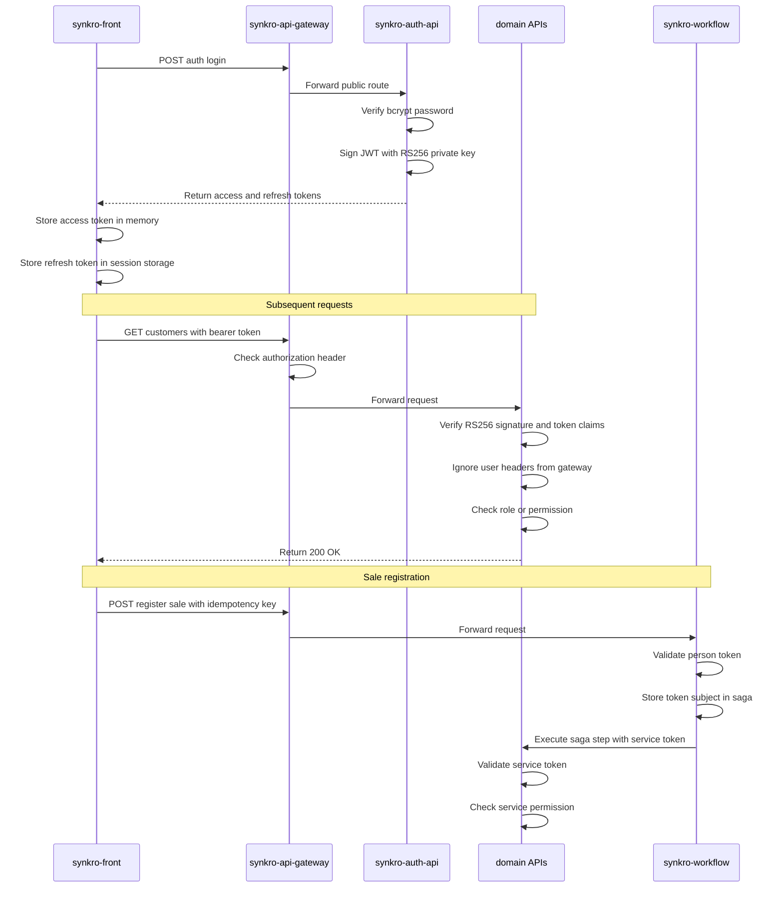

# Security Threat Model

> Threat analysis for the SynkroTech SAS system using the STRIDE
> methodology, applied to authentication, authorization and the calls
> between services. Each STRIDE category has at least one identified
> threat with its corresponding mitigation.

---

## Scope of the Analysis

This threat model covers the **JWT flow (RS256)** of ADR-001 §6 and ADR-006: login, token validation in every service, service tokens for
internal calls, and the sale-registration saga (ADR-007). Auth, Customers, Products and the saga store share one PostgreSQL instance per environment, isolated by schema and `GRANT` permissions (ADR-009). Sales owns the sales database in the separate MongoDB instance, isolated by database roles (ADR-010, ADR-012). Only the gateway and the frontend are published to the host (`05-architecture/deployment.md` §7).

### Analyzed Flow

---

## STRIDE Analysis

### S — Spoofing

| # | Threat | Affected Asset | Mitigation | Status |
|---|--------|---------------|------------|--------|
| S-1 | An attacker obtains valid credentials through brute force on `POST /api/v1/auth/login` | `synkro-auth-api` | Rate limiting at the gateway: maximum 10 attempts per IP within 5 minutes (`security-rules.md` A07). Progressive account lockout. Passwords hashed with bcrypt (cost factor ≥ 12) | Designed |
| S-2 | An attacker steals a token from the browser (XSS) and uses it to impersonate the user | All services | Access tokens have a short TTL (1 hour); the refresh token rotates on every use. CORS is configured once, at the gateway, for the frontend's origin only (`cross-cutting.md` §6). Content Security Policy on the frontend. Input validation to prevent XSS (`security-rules.md` A03) | Designed |
| S-3 | An attacker intercepts a refresh token and obtains new access tokens indefinitely | `synkro-auth-api` | Mandatory refresh token rotation on every use: a token can only be used once. If a revoked token is detected in use, ALL active tokens for that user are invalidated (`security-policy.md`) | Designed |
| S-4 | A caller sets `X-User-Id` or `X-User-Roles` to act as another user or role | All services | Services ignore every `X-User-*` header and read identity only from the validated token (ADR-006). A header can be set by anyone; a signature cannot | Designed |
| S-5 | A service token leaks (logs, a copied `.env`) and is used to call internal operations | Stock reservations, sale registration, stock alerts | Each service token carries only its service's permissions and the token-only role `SERVICE`; it expires after 30 days and is replaced before then; it is never logged and lives only in environment secrets (ADR-006, `security-policy.md`) | Designed |

---

### T — Tampering

| # | Threat | Affected Asset | Mitigation | Status |
|---|--------|---------------|------------|--------|
| T-1 | An attacker modifies the JWT payload (e.g., changes `roles: ["SALESPERSON"]` to `roles: ["ADMIN"]`) to escalate privileges | All services | The JWT is signed with RS256 (asymmetric key). Any modification invalidates the signature. Every service verifies the signature with the public key before accepting the token | Designed |
| T-2 | An attacker modifies data in transit between the frontend and a backend service (man-in-the-middle) | HTTP communication | HTTPS is mandatory in all environments except local. Minimum TLS 1.2, TLS 1.3 recommended (`security-policy.md`). HTTP is accepted locally because traffic does not leave the developer's machine | Designed |
| T-3 | One domain's database credentials modify another domain's data | Domain stores | PostgreSQL credentials grant access only to the owning schema; Sales credentials use sales_writer only in its MongoDB database, with find/insert/update and no remove. Services cannot use migration-owner credentials or access another domain's store (ADR-009, ADR-010, ADR-012). Verify effective privileges, including the append-only Auth audit exception | Designed |
| T-4 | An attacker changes the token header to `alg: none` or `HS256` (using the public key as a shared secret) | All services | Validators accept only `RS256` and reject every other algorithm explicitly, whatever the header says (ADR-006, `security-rules.md` A02) | Designed |
| T-5 | A retried or replayed creation request registers a sale twice or reserves stock twice | `synkro-workflow`, `synkro-products-api`, `synkro-sales-api` | Every creation requires `Idempotency-Key`, stored with the resource in one transaction; each saga step sends `Idempotency-Key: <sagaId>:<step>` (ADR-005, ADR-007) | Designed |
| T-6 | Someone alters the saga store to change a saga's outcome | `workflow_schema` | The saga store lives in its own schema in the shared instance; only `synkro-workflow` has credentials for `workflow_schema`, from environment secrets; the instance is never published to the host (ADR-007, ADR-009) | Designed |
| T-7 | Auth credentials are used to mutate creation evidence | user_creation_audit | New audit-table grants exclude UPDATE/DELETE/TRUNCATE for effective Auth application roles; audit write shares the user transaction; privileged database owners remain outside this guarantee (ADR-014) | Designed |
| T-8 | A malformed 400/404/422 response is mistaken for proof that no sale committed, causing release after a possible sale | Reserved stock and sale integrity | Validate operation-allowed status, JSON media type, one unambiguous object, status/error match and original trace; uncertain outcomes retain stock. Link [workflow-adapters/src/test/java/co/edu/corhuila/synkro/workflow/adapter/out/http/HttpSaleParticipantsTest.java](https://github.com/code-corhuila/synkro-workflow/blob/09a193866f05f3714a0bd1ad6d7559a9f00b3611/workflow-adapters/src/test/java/co/edu/corhuila/synkro/workflow/adapter/out/http/HttpSaleParticipantsTest.java); decision source remains ARQ-28 | Implementation observed; decision pending TD-013 |

---

### Saga rejection and replay boundaries

> Saga decision status and adoption boundary → [REST Guidelines](../07-api/guidelines.md#saga-decision-status).

The public projection omits initiatedBy, input, raw receipts, attempts, pendingStep, execution and error_detail. Local/protocol failures cannot be relabeled as business rejection or expose tokens, credentials, stored request data or driver diagnostics.

### R — Repudiation

| # | Threat | Affected Asset | Mitigation | Status |
|---|--------|---------------|------------|--------|
| R-1 | A user denies having performed an operation (e.g., creating or voiding a sale) | `synkro-sales-api` | Soft deletion preserves all operations (NFR-004). Structured logs with `userId`, `action`, `resource`, `result`, and `timestamp` (`security-policy.md` → Security Auditing). Correlation ID (`X-Correlation-Id`) enables end-to-end tracing | Designed |
| R-2 | An administrator denies having changed a user's role | `synkro-auth-api` | The `admin.role.changed` event is logged as a mandatory security event (`security-policy.md`). The `active` field with soft deletion preserves the user's previous state | Designed |
| R-3 | It is impossible to determine which user registered a specific sale | `synkro-sales-api` | `created_by` (ADR-002) is the `sub` of the salesperson's validated token, stored by the saga and sent to Sales, which accepts it only from a caller holding `sales:register` (ADR-006). Combined with structured logs (`cross-cutting.md` §2), every sale is attributable to a specific authenticated user | Designed |
| R-4 | A user creation has no attributable author | Auth | User, key and successful audit record commit together; initialization identifies the controlled deployment operator; rejected attempts log at detection (ADR-014) | Designed |

---

### I — Information Disclosure

| # | Threat | Affected Asset | Mitigation | Status |
|---|--------|---------------|------------|--------|
| I-1 | Backend error messages expose stack traces, table names, or SQL queries to the client | All services | Standardized error format (`cross-cutting.md` §1): the `message` field is generic; internal details are logged but never sent to the client. `INTERNAL_ERROR` (500) never includes a stack trace, and a failed saga returns only its failed step | Designed |
| I-2 | The JWT payload contains sensitive personal information (PII) that anyone can decode (JWT is signed, not encrypted) | `synkro-auth-api` | The JWT only contains: `sub` (user_id), `roles`, `permissions`, `iat`, `exp`, `jti`. It never contains: name, email, password, or card data (`security-policy.md` → JWT Prohibited in Payload) | Designed |
| I-3 | System logs contain tokens, passwords, or PII that an attacker with log access could exploit | All services | Logging rules explicitly prohibit sensitive data in logs (`cross-cutting.md` §2, `security-policy.md` → Secret Management). Logs record `userId` but never `email`, `password`, or `token` | Designed |
| I-4 | A user with the SALESPERSON role accesses another salesperson's sales data | `synkro-sales-api` | The use case compares `sale.created_by` with the `sub` of the person's validated token, so a SALESPERSON only sees their own sales (ADR-002, ADR-006) | Designed |
| I-5 | Audit or initialization inputs expose credentials | Auth audit and CLI | No password/hash/token/payload in evidence; protected input, restricted read access and environment-lifetime retention (ADR-014) | Designed |
| I-6 | Replaying another caller's key discloses stored input, owner or saga identifier | Saga creation/replay | Authenticate/authorize before replay; generic 403 for another caller, generic 400 for conflicting validated input; no row mutation or participant effects. GET access is not silently changed | Review candidate under ARQ-28 |

---

### D — Denial of Service

| # | Threat | Affected Asset | Mitigation | Status |
|---|--------|---------------|------------|--------|
| D-1 | An attacker sends thousands of requests to `POST /api/v1/auth/login` to saturate the authentication service | `synkro-auth-api` | Rate limiting at the gateway: maximum 10 attempts per IP within 5 minutes (`security-rules.md` A07). bcrypt is computationally expensive by design, which amplifies the impact of a flood — rate limiting is the first line of defense | Designed |
| D-2 | An attacker sends massive requests to business endpoints using valid stolen tokens | All services | The gateway is the only entry point and limits the request rate, answering `429` with `Retry-After` (ADR-008). Domain services are not published, so they cannot be flooded directly | Designed |
| D-3 | Slow queries exhaust datastore or host capacity | Shared PostgreSQL instance and Sales MongoDB instance | PostgreSQL contention can affect Auth, Customers, Products and Workflow (ADR-009). Sales reports aggregate indexed documents in MongoDB (ADR-010); they do not run against the PostgreSQL schemas. Bound driver pools and query work for each engine; a shared host can still have CPU/I/O contention, which requires measurement. The accepted shared-PostgreSQL single-point-of-failure tradeoff remains ADR-009/AT-002; this entry does not accept a new unmeasured MongoDB performance risk | Risk accepted |
| D-4 | Workflow ownership keys collide with Auth refresh keys, blocking unrelated work in the shared database | Auth availability and saga execution | Central overload/key usage registry, explicit cross-service allocation and deterministic collision/concurrency verification; schemas do not create lock isolation | Open TD-014; isolation not established |

---

### E — Elevation of Privilege

| # | Threat | Affected Asset | Mitigation | Status |
|---|--------|---------------|------------|--------|
| E-1 | A user with the INVENTORY role attempts to access sales or customer endpoints by calling the API directly (frontend bypass) | `synkro-customers-api`, `synkro-sales-api` | Each service validates the JWT and verifies the user's role has permission for the requested operation. Validation occurs in the application layer (use case), not the controller (`security-rules.md` A01). The frontend hides modules, but the real protection is in the backend | Designed |
| E-2 | An attacker crafts a fake JWT with `roles: ["ADMIN"]` without possessing the private key | All services | RS256 makes this impossible: the signature can only be generated with the private key, which lives exclusively in `synkro-auth-api`. The other services verify with the public key, which can only verify, not sign. A JWT signed with a different key is rejected immediately | Designed |
| E-3 | A user with direct database access modifies their own record in `auth_schema.system_user` to change their role to ADMIN | `auth_schema` | Only `synkro-auth-api` has credentials for `auth_schema`; no other service's credentials include a `GRANT` on that schema (ADR-009, ADR-005 Decision 3). The instance itself is never published to the host | Designed |
| E-4 | A salesperson calls the stock-reservation or sale-registration operation directly, to take stock without a sale or to register a sale under another person's name | `synkro-products-api`, `synkro-sales-api` | Those operations require the `stock:reserve`, `stock:release` or `sales:register` permission, which only the workflow's service token carries; stock reservations are not routed by the gateway at all (ADR-006, ADR-008) | Designed |
| E-5 | An unauthenticated or non-ADMIN caller creates an ADMIN | Auth register | Authentication adapter validates token; use case requires a human ADMIN, including replay; 401/403; SERVICE cannot register (ADR-014) | Designed |
| E-6 | An operator reuses initialization as recovery after all ADMIN roles disappear | Initialization CLI | Initialization-only authorization, no HTTP route, controlled operator and removal of routine command access; no lifetime marker; separate recovery decision TD-009 (ADR-014) | Designed |

---

## Status Summary

Designed identifies a documented mitigation, not proof of implementation. T-8, I-6 and D-4 are counted as Pending because their decision or isolation evidence remains open.

| Category | Threats Identified | Designed | Pending | Risk Accepted |
|----------|-------------------|----------|---------|---------------|
| Spoofing | 5 | 5 | 0 | 0 |
| Tampering | 8 | 7 | 1 | 0 |
| Repudiation | 4 | 4 | 0 | 0 |
| Information Disclosure | 6 | 5 | 1 | 0 |
| Denial of Service | 4 | 2 | 1 | 1 |
| Elevation of Privilege | 6 | 6 | 0 | 0 |
| **Total** | **33** | **29** | **3** | **1** |

---

## Correlations

* Security policy → `00-governance/security-policy.md`
* Technical security rules → `00-governance/security-rules.md`
* Token validation, service tokens and RBAC per resource → `07-api/authentication.md`, ADR-006
* RS256 public key distribution → `05-architecture/cross-cutting.md` §5
* Schema-per-domain isolation → ADR-009 (supersedes ADR-005 Decision 1); credentials and roles → ADR-005 Decision 3; network isolation → `05-architecture/deployment.md` §7
* Saga, idempotent steps and saga store → ADR-007
* Non-functional security requirements → `04-requirements/non-functional.md` NFR-004
* Sale authorship decision → `05-architecture/decisions/records/ADR-002-sale-authorship-traceability.md`
