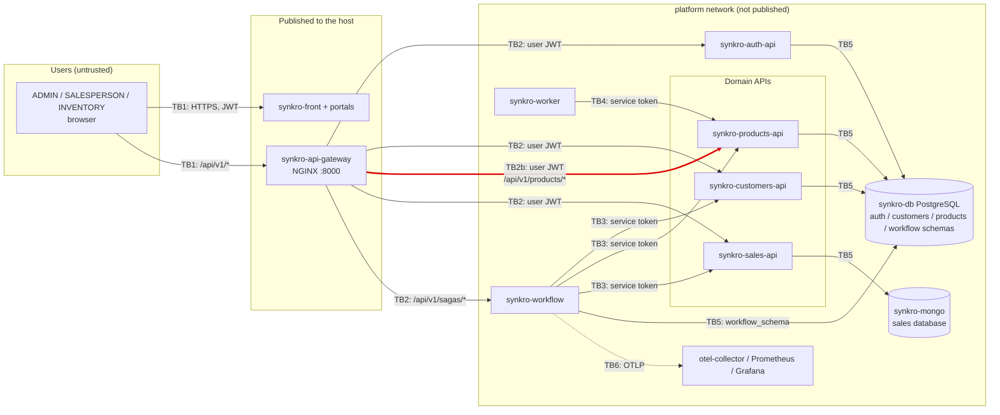

# Attack Surface and Trust Boundaries

## 1. Data flow diagram

Nodes come from `05-architecture/deployment.md`, ADR-006, ADR-007 and ADR-008.
There is no broker (RabbitMQ deferred, ADR-007 Decision 5) and no external API.
My boundary is **TB2b: synkro-api-gateway -> synkro-products-api** (red).

| Boundary | From | To | Why it is a boundary |
|---|---|---|---|
| TB1 | Browser (internet) | synkro-front, synkro-api-gateway | Untrusted users and devices |
| TB2 | synkro-api-gateway | auth, customers, sales APIs and synkro-workflow | The gateway only checks that a credential exists (ADR-006) |
| **TB2b** | **synkro-api-gateway** | **synkro-products-api** | **User requests that change the catalog, prices and stock; products-api is the only real check** |
| TB3 | synkro-workflow | customers, products and sales APIs | Machine-to-machine calls with the workflow service token |
| TB4 | synkro-worker | synkro-products-api | Scheduled job with its own service token |
| TB5 | Each service | Its schema or database | Per-schema credentials (ADR-009, ADR-010) |
| TB6 | Services | Observability stack | Logs and metrics leave the service |

## 2. Asset inventory

| Asset | Where it lives | Classification |
|---|---|---|
| Product catalog (`product`: name, `priceCents`, category, `active`) | `products_schema` | Internal |
| Product price (`priceCents`), copied into every sale by the saga | `products_schema` | Confidential (business) |
| Stock level and `stock_adjustment` history (`delta`, `reason`, `adjusted_by`) | `products_schema` | Internal |
| Categories (`category`) | `products_schema` | Internal |
| User access token (JWT with `sub`, `roles`, `permissions`) | Browser session, `Authorization` header | Restricted |
| `JWT_PUBLIC_KEY` to verify tokens | Environment of synkro-products-api | Public |

## 3. Entry points of TB2b

The gateway publishes port 8000 and routes `/api/v1/products/` and
`/api/v1/stock-alerts/` to `synkro-products-api:8080` (ADR-008). Stock reservations
are not routed. The table shows the write operations, the target of this model.

| Entry point | Called by | Allowed today (code) | Authentication today |
|---|---|---|---|
| `POST /api/v1/products` | Products portal (ADMIN, INVENTORY) | `canWriteCatalog`: role ADMIN or INVENTORY, or `products:write` | Gateway: header present. products-api: `requireAuth` checks only the JWT shape |
| `PUT /api/v1/products/{id}` (name, `priceCents`, category) | Products portal | Same | Same |
| `DELETE /api/v1/products/{id}` (deactivate) | Products portal | Same | Same |
| `POST /api/v1/products/{id}/stock-adjustments` (`delta`, `reason`) | Products portal (INVENTORY) | Same; `adjustedBy` = `sub` of the token | Same |
| `POST/PUT/DELETE /api/v1/products/categories[/{id}]` | Products portal | Same | Same |
| `GET /api/v1/products`, `GET /api/v1/products/{id}` | All portals, worker | `canReadCatalog` | Same |

Every write also carries `Idempotency-Key` and `X-Correlation-Id`.

Gap found in the code of synkro-products-api (`internal/adapter/in/httpapi/middleware.go`):
`requireAuth` and `claimsFrom` decode the token payload but **do not verify the RS256
signature**. The roles used by `canWriteCatalog` come from an unverified token.
